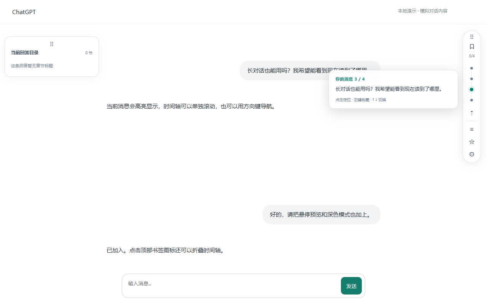
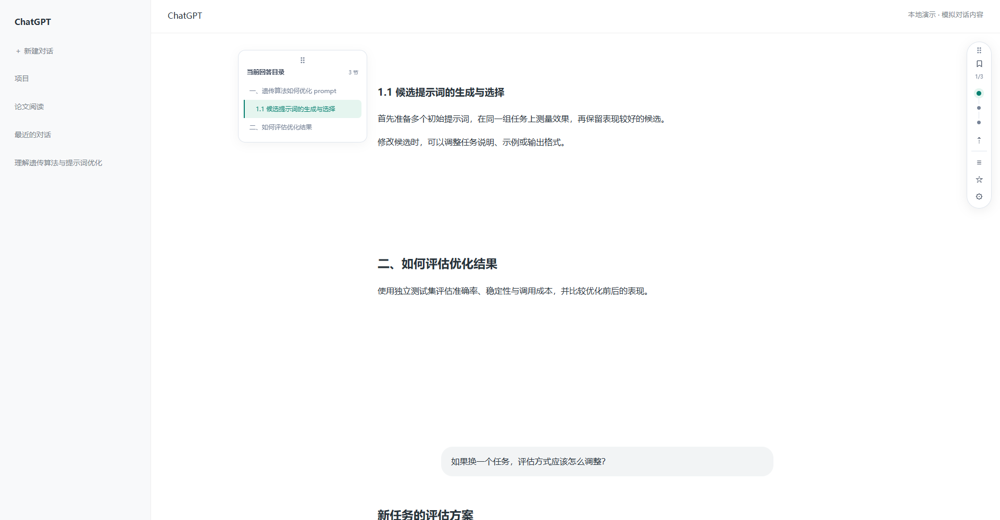

# ChatGPT 时间轴助手

> 写作日期：2026-10-03
> 范围：Microsoft Edge 桌面扩展，支持 ChatGPT 网站的消息导航、回答目录、收藏、公式复制、提示词库和输入换行。

## 1. 功能与安装

本扩展参考 Timeline 的交互功能独立实现 [R3]，面向 ChatGPT。无需构建、API Key 或付费服务。已兼容本次在 ChatGPT 页面实际观察到的新消息结构，同时保留旧版消息结构支持。

### 1.1 安装到 Edge

1. 在 Edge 地址栏输入 `edge://extensions/`。
2. 打开“开发人员模式”。
3. 点击“加载解压缩的扩展”，选择包含本项目 `manifest.json` 的文件夹。如果使用 ZIP，请先解压。
4. 刷新已经打开的 ChatGPT 页面。
5. 页面右侧会出现时间轴和工具按钮。建议先关闭原 Timeline 扩展，避免两条工具栏或输入快捷键相互影响。

安装方法遵循 Microsoft 官方的本地加载流程 [R1]。以后修改源码，先在扩展管理页面点击本扩展的“重新加载”，然后刷新 ChatGPT。

1.0.1 修复了部分桌面会话显示 `0/0` 的问题：这些页面只有 `data-user-message-bubble` 气泡标记，没有旧版消息角色属性。如果之前使用 ZIP 安装，请将新包解压覆盖原来加载的文件夹，再重新加载扩展并刷新页面。保持原加载路径，无需卸载扩展，可以保留提示词与收藏。

1.1.0 修复历史消息增量加载时书签列表跳动的问题，并增加“⇡ 加载历史消息”。更新方法不变：覆盖原目录，重新加载扩展，然后刷新 ChatGPT。

1.1.1 去掉了少量书签下方的大段空白：短列表按内容收紧，长列表超过高度上限后独立滚动。工具栏顶部位置固定；鼠标或键盘正在操作书签时，临时保持列表高度以避免新消息挤走圆点，操作结束后恢复紧凑布局。

1.2.0 增加左侧“当前回答目录”：按章节层级显示正在阅读的回答，点击跳转并高亮阅读位置；左侧空白不足时自动折叠成“目录”按钮，页面变宽后恢复展开。

1.3.0 支持拖动左右两侧书签栏，并分别记住位置。刷新页面、切换对话及重新打开浏览器后恢复；双击拖动手柄可恢复该栏的默认位置。

1.3.1 修复连续编号章节因网页标题标签混用而出现不同缩进的问题。同一组的 `1.`、`2.`、`3.`、`4.` 按并列章节对齐；`1.1`、`1.1.1` 等明确属于该组的子章节保留层级。无编号章节仍按网页标题结构显示。

1.4.0 改善生成过程中的书签跳转和卡顿：跳转后保持阅读目标，避免网页自动跟随输出把位置拉走；普通生成文字不再反复扫描用户消息和重建未变化的目录。在对话中途发送消息时保留阅读位置，接近底部时发送则保留网页的正常跟随行为。

1.4.1 修正 1.4.0 的持续定位回归：已结束回答恢复一次性跳转，不持续锁定滚动；仅检测到正在生成时启用导航保护，生成结束立即解除。网页复用标题或消息节点时不再追踪该节点到错误位置。新的书签跳转会解除之前发送时的位置保护。

1.4.2 撤回书签点击后的持续位置保护，左右书签统一改用浏览器原生定位，再留出顶部阅读间距。原生定位可同时移动多层滚动容器。发送时保留位置仍独立保留，点击书签会先解除它。功能设置中显示当前页面实际注入的版本，方便核对是否刷新生效。

1.4.3 补充发送位置保护：在进入输入框前记录阅读位置，避免输入框聚焦导致的自动滚底覆盖原位置；发送后若滚动容器被替换，恢复到新的容器。对没有已知发送按钮标记的页面，增加新用户消息与当前草稿匹配的检测。书签仍使用独立的原生跳转。

### 1.2 已实现的功能

- 消息时间轴：每条用户消息对应一个圆点，点击滚动定位，悬停或键盘聚焦显示消息预览。
- 阅读位置：当前消息圆点高亮，并显示当前序号与本次会话已索引的消息数。
- 回答目录：左侧显示当前回答的章节，点击跳转；随阅读位置切换回答，支持标题层级、动态更新及窄窗口自动折叠。
- 位置记忆：拖动两栏顶部的点阵手柄调整位置，松手后自动保存；窗口缩小时保持在可见范围内。
- 阅读位置保护：未停在底部时发送消息，保持正在阅读的位置；点击书签后解除保持并跳转。
- 长对话：圆点列表可独立滚动；按消息标识复用圆点，补入历史消息时保留列表阅读位置，不随页面滚动自动居中。
- 加载历史：点击“⇡”逐段向上检查更早的消息，结束后返回原阅读位置；可随时停止。
- 重要消息收藏：右键圆点，或聚焦圆点后按 `S`，收藏 / 取消收藏。
- 收藏列表：可搜索、复制、删除，或打开原会话并定位。收藏仅保存在本机。
- 提示词库：新建、编辑、搜索、复制、删除提示词，并追加到当前输入草稿。
- LaTeX 复制：鼠标悬停公式后出现“复制 LaTeX”按钮，复制公式的 TeX 源码。
- Enter 换行：默认开启，`Enter` / `Shift+Enter` 换行，`Ctrl+Enter` 发送；Mac 使用 `Command+Enter`。不干扰中文输入法选词。
- 外观：跟随页面深浅色模式，支持折叠和窄窗口。

## 2. 使用方式

### 2.1 时间轴与工具栏

点击顶部书签图标折叠或展开。“⇡”用于加载历史消息，其下三个按钮依次为提示词库、收藏消息、功能设置。

圆点可通过 `Tab` 聚焦，`↑` / `↓` 切换，`Home` / `End` 到第一条 / 最后一条，`Enter` 或空格定位，`Esc` 关闭预览。长消息的悬停预览会截断，点击定位后可阅读原文。



Fig. 2-1-1. 本地模拟对话中的时间轴、消息预览与工具入口。

### 2.2 提示词与输入快捷键

在提示词库点击“新建提示词”，填写名称和内容后保存。点击“使用”会在草稿末尾追加内容，不会覆盖已有草稿，也不会自动发送。

Enter 换行可在“功能设置”中关闭。开启时也可以使用 ChatGPT 原有的发送按钮。在 ChatGPT 正在生成回复时，扩展不会把 `Ctrl+Enter` 当作“停止生成”。

### 2.3 收藏与公式

收藏保存消息当时的文本、会话链接和定位标记，可在其他 ChatGPT 会话中通过收藏列表重新打开。临时对话、匿名会话、已删除的会话或尚未加载的消息可能无法重新定位，保存的文本仍可复制。

公式复制支持包含 TeX 源码的 KaTeX、MathJax、MathML 及显式 `data-latex` / `data-tex` 节点。图片公式或未保留源码的公式无法还原为 LaTeX。

### 2.4 历史记录分批加载

打开较长的旧对话后，点击右侧“⇡ 加载历史消息”。扩展会逐段向上滚动，让网页加载并呈现更早的消息。状态框显示已索引的提问数；加载结束后，扩展按原阅读消息的位置恢复页面。

点击“■”、手动滚动、触摸滑动、操作页面或切换会话会停止加载。用户手动停止后，扩展不会再次把页面拉回原位。每次检查最多运行 90 秒；到达顶部并约 3.6 秒没有变化时结束。网页加载较慢时可以再次点击检查，结束提示不代表服务器已提供全部历史。

已看到的消息会留在当前会话的内存索引中，避免网页临时移除屏幕外消息时圆点消失。暂未显示在页面中的消息使用淡色圆点，仍能预览；点击后尝试恢复其滚动位置，网页重新呈现消息后再精确定位。若网页未恢复该消息，会提示继续加载历史，不会把估算位置当作精确定位成功。

这份索引在刷新页面或切换会话时重建，不会自动写入本地存储。编辑或切换消息分支后，如仍看到已经移除的旧消息，可刷新重建索引。

### 2.5 当前回答目录

左侧目录放在 ChatGPT 自带侧栏与回答正文之间的空白处，按标题层级缩进显示。点击章节可滚动到对应位置；阅读到另一条回答时，目录自动切换，当前章节随滚动高亮。回答正在生成时，新出现的标题会自动补入。

点击“当前回答目录”可手动折叠或展开。窗口变窄、左侧空间不足时，目录自动收成“目录”按钮，避免持续遮挡正文；点击按钮可临时展开，再次点击收起。窗口变宽、空间恢复后自动展开；如果在宽窗口下手动折叠过，则保留手动选择。

目录读取当前已呈现回答中的章节标题，不包含提问、引用块、代码和表格内部的标题。没有章节标题的回答显示“这条回答暂无章节标题”，不会把普通段落自动编成目录。只有加粗、未使用标题结构的文本不列入目录。



Fig. 2-5-1. 本地模拟对话中的左侧目录、层级缩进与当前章节高亮。

### 2.6 拖动与位置记忆

左右两栏顶部都有“⠿”拖动手柄。按住手柄拖动，松开后自动保存该栏的位置；拖动不影响目录折叠按钮或消息圆点的点击操作。两栏位置独立保存，同一浏览器配置中的 ChatGPT 对话共用，新打开的页面也会恢复。

窗口缩小时，两栏会临时限制在屏幕范围内，左侧目录继续按可用空间自动折叠；窗口变大后恢复记住的位置。仅改变窗口大小不会覆盖已保存的位置。

双击某一栏的手柄，可恢复该栏的默认位置。用 `Tab` 聚焦手柄后，方向键每次移动 10 像素，`Shift` 加方向键微调 1 像素，`Home` 恢复默认位置。拖动过程中按 `Esc` 可取消本次移动。

位置保存在扩展本地存储中，刷新、切换对话和正常关闭浏览器不会清除；卸载扩展或清除扩展数据会重置。更新时保持原来的加载目录，无需卸载。

### 2.7 生成与发送时保持阅读位置

点击右侧消息圆点或左侧章节目录后，扩展通过浏览器原生定位滚动到目标，再保留顶部阅读间距。书签跳转与发送位置保护分开，点击书签会解除旧保护；不会持续追踪节点或强制纠正后续滚动。

1.4.2 暂时撤回生成期间的强制跟随对抗逻辑。如果网页在生成时再次主动滚底，本版不会一直强制拉回。普通生成段落仍不会触发整段对话索引和未变化目录的重复重建；新增消息、章节或章节文字变化仍会更新。

如果当前没有接近对话底部，通过发送按钮、`Ctrl/Command+Enter`，或关闭“Enter 换行”后的原生 Enter 发送消息，会保持当前阅读位置。如果已经接近底部，则允许网页正常跟随最新回复。

位置会在进入输入框前预先记录，但此时不会锁定滚动；确认发送或检测到匹配草稿的新用户消息后才启用保持。如果输入框聚焦时网页已经自动跳到底部，则使用进入输入框前的位置。发送后网页替换滚动容器时，也会尝试在新容器恢复。仅换行、输入法选词或编辑草稿不会触发发送。

主动滚动鼠标、触摸滑动、使用页面滚动键或点击正文及网页的“回到底部”控件，会解除位置保持。再次点击书签会改为保持新的目标；加载历史和切换到其他会话也会解除旧目标。输入框里的编辑、换行和输入法选词不会主动发送消息。

位置保护依赖网页已呈现的内容与滚动容器，不调用 ChatGPT 私有接口。网页虚拟化移除阅读目标时会先保留滚动位置；从未加载的历史内容仍需要通过网页加载。

## 3. 兼容性与数据

### 3.1 页面更新适配

本次在 ChatGPT 的匿名测试会话中观察到了以下标记：

- 对话列表：`data-conversation-transcript`。
- 用户消息：`data-message-role="user"`。
- 用户正文：`data-user-message-copy` / `data-user-message-bubble`。
- 输入框：`mobile-composer-prompt` / `data-mobile-composer-prompt`。
- 发送按钮：`data-composer-submit`，同一个按钮可能切换成“停止生成”。

旧版 `data-message-author-role="user"` 和 `prompt-textarea` 仍然受支持。扩展自动寻找实际可滚动容器，避免只滚动浏览器窗口却没有移动对话区域。不同账号或灰度版本的页面结构仍可能存在差异；这些 DOM 属性并非 ChatGPT 提供的稳定扩展接口。

根据用户提供的桌面页面检查截图，1.0.1 还直接识别 `data-user-message-bubble="true"`，并读取内部的 `.whitespace-pre-wrap` 正文。角色属性与气泡同时出现时仅生成一个圆点；无布局框的 `display: contents` 包装层不会使内部气泡被排除，隐藏的旧会话容器也不会阻断可见消息的识别。

时间轴索引本次会话中已在页面出现的用户消息，不调用私有接口拉取历史记录。“加载历史”通过网页的滚动加载机制工作，无法保证网站一次提供全部记录，也不能索引从未呈现的内容。缺少稳定消息标识时使用文本辅助识别，完全相同的重复提问在部分虚拟列表中可能无法准确区分。

### 3.2 本地存储与权限

扩展仅匹配 `https://chatgpt.com/*` 和 `https://chat.openai.com/*`。当前版本不包含 Gemini 等其他平台适配，也不提供跨浏览器同步。

- `storage`：在扩展本地存储中保存用户主动创建的提示词、收藏、功能设置和两栏位置。
- `clipboardWrite`：点击复制按钮时写入剪贴板。
- 自动注入的内容脚本：读取消息节点并在页面右侧显示工具栏，采用 Manifest V3 的静态内容脚本机制 [R2]。

扩展没有后端，不发送网络请求，不自动保存全部聊天内容。卸载扩展会清除扩展本地存储。浏览器扩展管理页面会显示此扩展能够读取和更改 ChatGPT 网站数据，这是页面注入和消息定位所需的访问范围。

## 4. 开发与验证

### 4.1 文件

- `manifest.json`：Edge 扩展清单、网站范围和权限。
- `content.js`：消息识别、圆点、预览、滚动与主题。
- `extras.js`：收藏、提示词、公式复制、输入快捷键和设置。
- `outline.js`：当前回答识别、章节目录、滚动高亮与空间不足时自动折叠。
- `positions.js`：拖动手柄、位置保存与恢复、键盘微调，以及窗口边界和浮层位置限制。
- `reading.js`：仅处理发送前的位置保护和解除；书签跳转独立由 `content.js` 中的原生定位处理。
- `tests/fixture.html`：含新版页面语义标记的本地模拟对话。
- `tests/desktop-bubbles.html`：按用户截图中的桌面消息嵌套结构构造的回归样例，使用模拟文本与标识符。
- `tests/outline.html`：含多层标题、无布局框包装层和原生侧栏的回答目录测试样例。
- `tests/bookmarks.test.cjs`：使用真实 Edge 加载扩展的自动化测试。

### 4.2 运行测试

开发测试需要本机安装 Node.js 和 Edge；正常安装使用扩展不需要 Node.js。

```powershell
npm install
npm run check
npm test
```

测试在独立的 Edge 配置目录中加载真实扩展，并把测试地址响应替换为本地对话样例，不读取个人浏览器配置。覆盖新旧消息结构、滚动定位、动态更新、长对话、主题、键盘操作、提示词持久化、收藏持久化、输入法保护、公式剪贴板和发送 / 停止按钮区分。

临时 Edge 配置创建在系统临时目录，浏览器关闭后清理；不再把这些大型测试数据放进扩展加载目录。测试截图仍输出到 `test-results`，发布包不包含该目录。

1.1.0 的回归测试覆盖历史分批加载、阅读位置恢复、手动取消、小列表与长列表插入旧消息时的圆点位置、节点重建、屏幕外消息缓存，以及先切换 URL 后替换消息的会话切换。验证基于真实 Edge 和模拟网页行为，不等于已在所有登录账号或灰度布局中完成验证。

1.2.0 增加目录层级、章节跳转、阅读高亮、回答切换、流式标题更新、无标题回答、会话切换，以及宽度为 1920、900 和 390 像素时自动折叠与展开的回归验证。

1.3.0 增加两栏独立拖动、新标签页与刷新后恢复、切换会话后恢复、窄窗口边界限制、变宽后恢复、双击复位、取消拖动、键盘移动，以及拖动后预览和工具面板位置的回归验证。

1.3.1 增加混用标题标签的四个并列章节对齐、对应章节跳转、流式新增章节，以及不同章节组和多级子标题的回归验证。

1.4.0 增加持续输出并强制自动滚底时的消息与章节跳转、手动滚动解除、在中途或底部发送、键盘发送及输入法保护，并验证普通流式段落不会改写已有书签按钮和目录文字。自动滚底采用每 20 毫秒执行一次的模拟网页场景；真实账号的灰度行为仍可能不同。

1.4.1 增加已结束回答跳转、标题和消息节点被复用到底部、生成结束解除导航保护，以及发送位置保护后再次点击左右书签的回归验证。旧版已在标题节点复用样例中复现跳到底部，修正版通过对应验证。

1.4.2 增加多层滚动容器回归：先执行旧算法，确认仅滚动内层会使目标仍在屏幕外，再验证原生定位能显示消息和章节。书签持续强制对抗自动滚底的测试随功能撤回，替换为验证普通输出期间跳转不安装持续滚动锁。测试只证明所覆盖样例，不等于已验证用户实际会话。

1.4.3 增加输入框聚焦先滚底、发送后替换滚动容器，以及无已知按钮属性且不触发表单提交时新增用户消息的测试。

## 参考文献

[R1] Microsoft. *Sideload an extension to install and test it locally*. Microsoft Learn, 访问于 2026-10-01. https://learn.microsoft.com/en-us/microsoft-edge/extensions/getting-started/extension-sideloading

[R2] Chrome for Developers. *Content scripts*. Chrome Extensions Documentation, 访问于 2026-10-01. https://developer.chrome.com/docs/extensions/develop/concepts/content-scripts

[R3] houyanchao. *Timeline：ChatGPT、Gemini 对话增强*. Microsoft Edge Add-ons, 访问于 2026-10-01. https://microsoftedge.microsoft.com/addons/detail/timeline-chatgpt-gemin/ekednjjojnhlajfobalaaihkibbdcbab
